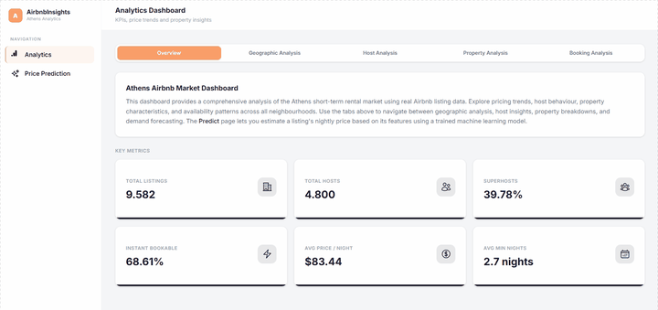

# Airbnb Price Prediction – Athens

End-to-end data science project on Airbnb listings in **Athens, Greece**: exploratory analysis, preprocessing, model selection, explainability (SHAP) and a web application that lets you explore the market and predict the nightly price of a listing.



## Features

- **Market dashboard** – KPIs, price analysis, geographic distribution (map), property types, host insights and availability.
- **Price prediction** – enter the characteristics of a listing and get an estimated price per night.
- **Model insights** – comparison of the trained models and SHAP feature importance.
- **Reproducible pipeline** – preprocessing, hyper-parameter tuning (Optuna) and SHAP analysis in a single script.
- **Review translation** – optional script that translates Greek reviews to English with a local Ollama model.

## Model

Several regressors were compared (Ridge, ElasticNet, Random Forest, Extra Trees, Gradient Boosting, HistGradientBoosting, XGBoost and a stacking ensemble). The best one is the **stacking ensemble**.

Full results are in [output/models/models_evaluation.json](output/models/models_evaluation.json).

## Tech stack

| Layer | Technologies |
|---|---|
| Data / ML | pandas, NumPy, scikit-learn, XGBoost, Optuna, SHAP |
| Backend | FastAPI, Uvicorn, Pydantic |
| Frontend | Next.js 14, React 18, TypeScript, Tailwind CSS, Recharts, Leaflet |

## Repository structure

```
├── backend/        FastAPI app (backend/app) and modeling code (preprocessing, modeling, shap)
├── frontend/       Next.js application
├── notebooks/      Analysis notebooks (EDA, preprocessing & model selection, stats creation)
├── scripts/        run_pipeline.sh (train) and run_reviews.sh (translate reviews)
├── data/           Raw source CSV files (listings, reviews)
├── output/
│   ├── processed/  Preprocessed datasets and artifacts
│   ├── models/     Trained model and evaluation reports
│   └── shap/       SHAP analysis results
└── api/            Legacy Flask API (superseded by backend/)
```

## Getting started

### Prerequisites

- Python 3.10+
- Node.js 18+ and npm

### 1. Backend (FastAPI)

From the repository root:

```bash
python -m venv .venv
# Windows: .venv\Scripts\activate    macOS/Linux: source .venv/bin/activate
pip install -r requirements.txt

uvicorn backend.main:app --reload --port 8000
```

(If you use [uv](https://docs.astral.sh/uv/), `uv sync` works too.)

The API runs on <http://localhost:8000> and the interactive docs are at <http://localhost:8000/docs>.

### 2. Frontend (Next.js)

In a second terminal:

```bash
cd frontend
npm install
npm run dev
```

Open <http://localhost:3000>. The frontend calls `http://localhost:8000/api/v1` by default; to change it, set `NEXT_PUBLIC_API_BASE_URL` in `frontend/.env.local`.

## API endpoints

All routes are prefixed with `/api/v1`.

| Method | Route | Description |
|---|---|---|
| GET | `/health` | Health check |
| GET | `/kpis` | Key performance indicators |
| GET | `/price-analysis` | Price distribution and analysis |
| GET | `/geo-distribution`, `/geo-distribution/grouped` | Listings by neighbourhood |
| GET | `/property-type-distribution` | Property type breakdown |
| GET | `/host-insights`, `/host-analytics` | Host statistics |
| GET | `/property-analytics`, `/availability-analytics` | Property and availability statistics |
| GET | `/model-performance` | Model comparison and SHAP results |
| GET | `/prediction-options` | Allowed values for the prediction form |
| POST | `/predict` | Predict the price of a listing |

## Re-training the model

Runs preprocessing → modeling (Optuna tuning) → SHAP (use Git Bash / WSL on Windows):

```bash
./scripts/run_pipeline.sh [N_TRIALS=50] [DATA_PATH=data/listings.csv]
```

Outputs are written to `output/processed/`, `output/models/` and `output/shap/`.


## Author

Athina Mousia
